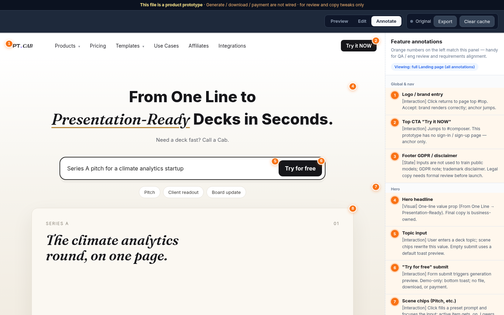
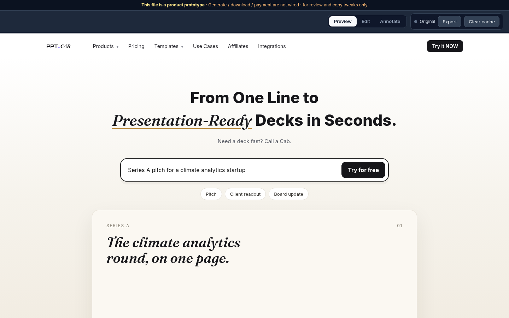
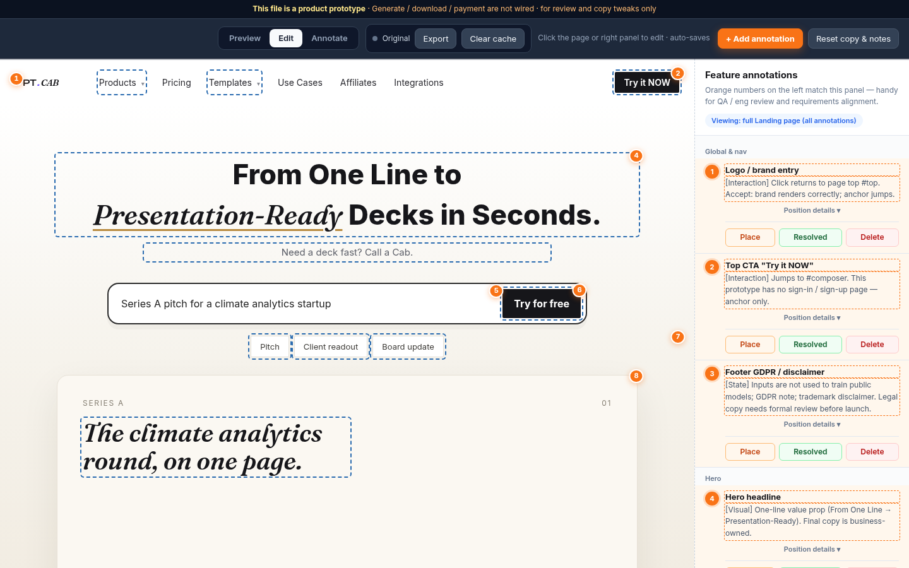

# HTML Prototype Studio

**Turn a single-page HTML product prototype into a reviewable delivery artifact.**

Drop a three-mode shell around your landing page or product mock: **Preview** the clean page, **Edit** copy and place pins, **Annotate** for QA / eng review — then export the right HTML for each audience.

<p align="center">
  
</p>

<p align="center">
  
  &nbsp;
  
  &nbsp;
  
</p>

<p align="center"><sub>Preview · Edit · Annotate — screenshots from <code>examples/landing-modes.html</code></sub></p>

---

## The problem

Product prototypes usually live as static HTML or Figma dumps. Reviewers then ask:

- Where does this control go?
- Is this wired or demo-only?
- Which copy is final?

Sharing three different files (clean / annotated / editable) is painful. So is explaining pins in a Slack thread.

## The solution

One self-contained `.html` with a dark chrome toolbar:

| Mode | Who | What |
|------|-----|------|
| **Preview** | Stakeholders | Full-width page, no pins or panel |
| **Edit** | Product | Edit copy, place pins then write notes, mark resolved / delete |
| **Annotate** | QA / eng | Read-only orange pins + matching right panel |

Edits auto-save to `localStorage`. Export follows the current mode.

## Features

- **Place → then write** — grey ghost pin first, orange after you submit the note
- **Region-ordered numbers** — add / delete renumbers `1..n` by section groups
- **Resolved / Reopen / Delete** — open pins stay orange; resolved go grey
- **Position details collapsed** — anchor + offsets stay out of the way until expanded
- **Mode-aware export** — `*.preview.html` / `*.annotated.html` / `*.edited-annotated.html`
- **Dark toolbar** — visually separated from the cream / page body so chrome never blends into content
- **Works offline** — open the file locally; no build step

## Quick start

1. Clone this repo (or download the example).
2. Open [`examples/landing-modes.html`](examples/landing-modes.html) in a browser (double-click is fine).
3. Try the top modes:
   - **Preview** — clean marketing page
   - **Edit** — click **+ Add annotation**, click the page to place a pin, then fill the dialog
   - **Annotate** — read-only review for handoff
4. Use **Export** / **Clear cache** / **Reset copy & notes** from the toolbar as needed.

> Tip: start in **Edit** to place notes, then switch to **Annotate** before you send the file to eng.

## How to annotate

1. Switch to **Edit**.
2. Click **+ Add annotation** in the top toolbar.
3. Click the target on the page (crosshair + grey ghost).
4. Fill **Title**, **Description**, and **Group** → **Add** (pin turns orange).
5. Optional: **Place** to reposition, **Resolved** / **Reopen**, or **Delete**.
6. Expand **Position details** only when you need the selector / offsets.

## Agent skill

[`SKILL.md`](SKILL.md) is an English Cursor / OpenClaw-style skill for wrapping *your* prototype:

1. Use `examples/landing-modes.html` as the gold sample (port chrome, don’t rewrite it).
2. Put product body in `#protoMainScroll`.
3. Fill `PROTO_ANNOTATION_GROUPS` + `PROTO_ANNOTATIONS`.
4. Walkthrough modes, place flow, export, and cache reset.

## Repo layout

```
html-prototype-studio/
  README.md
  LICENSE                 # MIT
  SKILL.md                # Agent skill (English)
  examples/
    landing-modes.html    # Working demo (PPT.CAB landing + three-mode chrome)
  docs/
    mode-preview.png
    mode-edit.png
    mode-annotate.png
```

## Contributing

Issues and PRs welcome — especially:

- Smaller / multi-step prototypes as extra examples
- Accessibility polish on the chrome
- Export options (strip markers, print CSS, etc.)

If this saved you a review cycle, a **⭐ star** helps others find it. Thank you!

## License

[MIT](LICENSE) © 2026 Tad Jones
